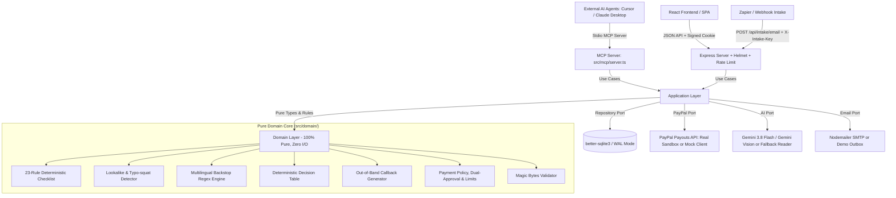

# 🛡️ PayGuard Agent

> **Tagline:** An AI agent that checks payment-request emails and invoice attachments against your PayPal payment history, holds anything suspicious, and only sends money after humans approve.  
> **Target Award:** PayPal AI Hackathon — Best Use of Agentic Commerce.

---

## ⚡ 30-Second Quickstart (Zero Credentials Required!)

PayGuard Agent works completely out of the box with zero API keys or external credentials required:

```bash
# 1. Clone & install dependencies
git clone https://github.com/NPushpanjali-30/PayGuard-Agent.git
cd PayGuard-Agent
npm install

# 2. Seed realistic vendors & payment history (local SQLite)
npm run seed

# 3. Start production server (serves both API & React UI)
npm run build && npm start
```

Open **`http://localhost:3000`** in your browser:
1. Log in with the default password: **`payguard2026!`** (or as multi-approver `alice:password1` / `bob:password2`).
2. Head to **Check Email** and click the demo chip: **`🚨 Fraud: New Payee`** or try **`Try Sample PDF`**.
3. Click **Check This Email** → Observe instant **`HOLD`** verdict, locked payee on file, and phone callback script.
4. Click **`✓ Honest: Cloud Invoice`** → Click **Approve** → Watch status progress from `PENDING` to **`PAID`** via simulated PayPal Payouts.

---

## 🚀 Key Features

1. **Multimodal PDF & Image Invoice Extraction:** Analyzes attached invoices (PDF, PNG, JPG up to 5 MB) with Gemini vision and deterministic fallback. Validates magic bytes to prevent polyglot attacks and cross-checks extracted payee, IBAN, and amount against email claims and verified vendor records.
2. **Cryptographic Out-of-Band Vendor Confirmation:** Sends a single-use SHA-256 tokenized verification link to the vendor's verified contact email on file. Vendors confirm or deny without logging in (`GET /confirm/:token`). If denied, the proposal is auto-blocked. Operates in real SMTP mode or zero-credential Demo Outbox mode.
3. **Dual-Person Approval & Cooling-Off Governance:** Transactions over `$1,000` (configurable) or to first-time payees mandate approval from two distinct approvers. New payees undergo a 24-hour cooling-off period before funds can be released.
4. **Zapier & Webhook Automated Email Intake:** Secure webhook pipeline (`POST /api/intake/email`) authenticated via `X-Intake-Key` with 8 MB payload support and `messageId` idempotency cache, seamlessly integrating Gmail and Outlook into the protection loop.
5. **Model Context Protocol (MCP) Server:** Standalone stdio MCP server (`npm run mcp`) exposing 5 safe tools (`payguard_check_email`, `payguard_request_payment`, `payguard_list_pending`, `payguard_get_proposal`, `payguard_vendor_lookup`). Autonomous AI agents can verify risks and queue proposals, but only humans approve in the web app.
6. **Dynamic Threat Intelligence & Blocklist Learning:** Rejection of fraudulent proposals offers one-click blocklisting of attacker domains and payee identifiers, with strict immunity protecting verified vendors on file.

---

## 📐 System Architecture

PayGuard Agent strictly enforces **Hexagonal / Clean Architecture**. Domain security rules have zero external dependencies or I/O.



To verify layer boundaries at any time, run:
```bash
npm run layers
```
*(Fails immediately if `src/domain/` imports from `application/`, `adapters/`, `server/`, or `web/`).*

---

## 💳 Exactly How PayPal is Used

1. **PayPal Payouts API (`POST /v1/payments/payouts`):**
   - Automatically triggered when human approval conditions are satisfied.
   - Enforces **Idempotency** via `sender_batch_header.sender_batch_id = proposal.id`, preventing duplicate payouts.
   - Dispatches single or batch item disbursements with custom memo references.
2. **Payout Status Polling (`GET /v1/payments/payouts/{batch_id}`):**
   - Tracks transaction lifecycle: `PENDING` → `PROCESSING` → `SUCCESS` / `DENIED`.
   - UI automatically polls every 3 seconds until a terminal state is reached.
3. **Transaction Search & History Sync (`GET /v1/reporting/transactions`):**
   - Syncs historical disbursements over a 90-day window, chunking into 31-day intervals to adhere to PayPal Reporting API constraints.
   - Recomputes vendor median amounts and builds local payee baselines. Gracefully falls back to local history if disabled.
4. **Webhook Signature Verification (`POST /v1/notifications/verify-webhook-signature`):**
   - Validates incoming PayPal webhook events (`PAYMENT.PAYOUTSBATCH.SUCCESS`) against PayPal's verification certificate endpoint.
5. **Built-in Mock Client:**
   - Full in-memory stateful simulation of all PayPal endpoints for offline development and instant hackathon demonstrations.

---

## 🤖 Exactly How AI is Used

1. **Structured Invoice Extraction (Google Gemini 2.5 Flash):**
   - System prompt treats all email text and attachment data strictly as **untrusted data**, preventing prompt injection.
   - Enforces structured JSON output schema: `vendorName`, `paymentRequested`, `payeeChangeRequested`, `payeeChangeMentioned`, `newPayeeIdentifiers`, `amount`, `currency`, `tactics` (urgency, secrecy, authority, avoid_phone), `channelShift`, `giftCards`, `phonesInEmail`.
   - Runs with `temperature: 0`, 30s timeout, and automated retry. Works across any language (English, Spanish, French, German, Portuguese, etc.).
2. **Multimodal Invoice PDF/Image Vision (Gemini 2.5 Flash):**
   - Directly ingests base64-encoded PDF or image bytes via inline data buffers.
   - Extracts structured invoice data and proactively detects concealed prompt injection instructions inside the document.
3. **Independent Second Opinion Judge:**
   - A separate, decoupled Gemini call evaluates the email independently, returning `{ verdict: HOLD|CHECK|CLEAR, reason }`. It can add security flags, but can never dismiss flags raised by the deterministic engine.
4. **Deterministic Fallback Reader:**
   - If no `GEMINI_API_KEY` is provided, PayGuard automatically runs in fallback mode using its keyword and regex extraction engine.
   - **Safety Invariant:** The fallback reader *never* returns a bare `CLEAR` for an email requesting money; it always returns `CHECK` to demand human verification.

---

## 🛡️ The 23-Rule Deterministic Checklist

| Rule ID | Severity | Description |
| :--- | :--- | :--- |
| `bank_change` / `payee_change` | **HIGH** | Explicit request to change payee account, routing number, or IBAN |
| `lookalike_domain` | **HIGH** | Levenshtein typosquatting, homoglyphs (e.g. 0 for o), swapped TLDs (.co), hyphen tricks |
| `reply_to_mismatch` | **HIGH** | `From:` domain routes responses to an external unlisted `Reply-To:` address |
| `gift_cards` | **HIGH** | Untraceable currency requests (Apple gift cards, Steam cards, Bitcoin, USDT) |
| `auth_fail` | **HIGH** | SPF, DKIM, or DMARC failures detected in `Authentication-Results` headers |
| `new_payee_identifier` | **HIGH** | Email requests payment to a PayPal account never paid before |
| `attachment_payee_mismatch` | **HIGH** | Payee in attached invoice differs from email body or verified vendor record |
| `attachment_amount_mismatch` | **HIGH/MED** | Severe amount discrepancy between attachment and email (HIGH if >= 2x difference) |
| `attachment_new_payee` | **HIGH** | Invoice attachment introduces a new payee account absent from vendor history |
| `attachment_hidden_instructions` | **HIGH** | Prompt injection or suspicious override instructions detected inside attachment |
| `blocklisted_sender` | **HIGH** | Sender address or domain matches learned security blocklist |
| `blocklisted_payee` | **HIGH** | Payee identifier matches learned attacker blocklist |
| `attachment_not_read` | **MEDIUM** | Attachment could not be read (corrupt file, parse error, timeout); forces CHECK |
| `payee_change_notice` | **MEDIUM** | Advance notice announcing future banking transition |
| `sender_not_on_file` | **MEDIUM** | Sender domain is not registered under the matched vendor record |
| `unknown_vendor` | **MEDIUM** | First-time requester with no prior transaction history |
| `free_mail_payment` | **MEDIUM** | Commercial vendor billing from free consumer webmail (Gmail, Yahoo, Outlook) |
| `subdomain_sender` | **MEDIUM** | Unusual nested multi-level subdomains masking true host |
| `amount_anomaly` | **MEDIUM** | Requested amount exceeds 3x the vendor's historical median payout |
| `pressure` | **MEDIUM** | Social engineering tactics (artificial deadlines, secrecy, executive authority) |
| `channel_shift` | **MEDIUM** | Requesting communication shift to WhatsApp, Telegram, or personal SMS |
| `model_judgement` | **HIGH/MED** | Independent Gemini second opinion flagged the correspondence |
| `no_ai_reader` | **MEDIUM** | Cautious fallback mode flag mandating human verification |

---

## 🧪 Evaluation Benchmark Results

We evaluated PayGuard Agent against an expanded benchmark of 52 original labeled test cases (`data/eval/emails.jsonl`), including 27 fraud scenarios (multilingual BEC, homoglyphs, PDF payee substitutions, prompt injections, blocklisted senders/payees, confirmation denials) and 25 honest scenarios (routine cloud bills, matching PDF invoices, office supplies, freight invoices, confirmed payments):

```
======================================================
              PAYGUARD EVALUATION BENCHMARK           
======================================================
Total Emails Tested:           52 (27 fraud, 25 honest)
Reader Mode:                   Deterministic Fallback (Keyword/Regex)
Frauds Intercepted (HOLD):     23 / 27 (85.2%)
Frauds Flagged (CHECK):        4 / 27 (14.8%)
Frauds Slipped Through (CLEAR):0 / 27 (0.0% false negatives)
Overall Fraud Catch Rate:      27 / 27 (100.0%)
Honest Invoices Cleared:       7 / 25 (28.0%)
Honest Invoices Checked:       18 / 25 (72.0%)
Honest Invoices Frozen (HOLD): 0 / 25 (0.0% false positives)
Verdict Breakdown:             HOLD: 23 | CHECK: 22 | CLEAR: 7
======================================================
```

> **Honest Disclaimer on Evaluation:** This dataset is author-written, synthetic, and relatively small (52 emails). We distinguish clearly between **HOLD** (high-risk unauthorized payment attempt stopped and locked to verified records) and **CHECK** (human verification required due to cautious fallback mode or social engineering signals). Crucially, **zero frauds were cleared** (0.0% false negatives), and **zero honest invoices were wrongly frozen as HOLD** (0.0% false positives).

To execute the benchmark locally:
```bash
npm run eval
```

---

## ⚙️ Environment Configuration

Copy `.env.example` to `.env`:

| Variable | Description | Default |
| :--- | :--- | :--- |
| `PORT` | Server listening port | `3000` |
| `NODE_ENV` | Application environment (`development` or `production`) | `development` |
| `APP_PASSWORD` | Master password for dashboard authentication | `payguard2026!` |
| `APPROVERS` | Multi-approver credentials list (e.g. `alice:password1,bob:password2`) | `""` (falls back to `APP_PASSWORD`) |
| `APP_BASE_URL` | Application base URL used to construct links | `http://localhost:3000` |
| `SESSION_SECRET` | Secret key used for signing session cookies | *(change in prod)* |
| `PAYPAL_MODE` | PayPal integration mode: `mock` or `sandbox` | `mock` |
| `PAYPAL_CLIENT_ID` | PayPal Sandbox Client ID | `""` |
| `PAYPAL_CLIENT_SECRET` | PayPal Sandbox Client Secret | `""` |
| `PAYPAL_WEBHOOK_ID` | Optional PayPal Webhook ID for signature verification | `""` |
| `GEMINI_API_KEY` | Google Gemini API key (if unset, uses fallback reader) | `""` |
| `GEMINI_MODEL` | Google Gemini model ID | `gemini-3.8-flash` |
| `APPROVAL_LIMIT` | Amount ($) requiring explicit typed amount confirmation | `500` |
| `HARD_LIMIT` | Hard threshold ($) above which in-app payouts are blocked | `5000` |
| `CONFIRMATION_TTL_HOURS` | Out-of-band vendor confirmation link expiration time (hours) | `24` |
| `SMTP_HOST` | Outbound SMTP server hostname (if unset, runs in Demo Outbox mode) | `""` |
| `SMTP_PORT` | Outbound SMTP port | `587` |
| `SMTP_USER` | Outbound SMTP username | `""` |
| `SMTP_PASS` | Outbound SMTP password | `""` |
| `SMTP_FROM` | Outbound SMTP from-address | `""` |
| `DUAL_APPROVAL_THRESHOLD` | Amount ($) above which 2 distinct human approvers are required | `1000` |
| `NEW_PAYEE_COOLING_OFF_HOURS` | Holding period (hours) for payees with no prior payment history | `24` |
| `DEMO_FAST_FORWARD` | Demo mode flag enabling the "Demo: skip waiting" button | `false` |
| `INTAKE_API_KEY` | Secret API key for incoming Zapier/webhook email intake (route disabled if unset) | `""` |
| `DB_PATH` | Path to SQLite database file | `./data/payguard.db` |
| `SEED_RECIPIENTS` | Comma-separated sandbox buyer emails for real test payouts | `""` |

---

## 🚀 Running Locally & Switching to Sandbox

### Mock Mode (Zero Credentials)
```bash
npm install
npm run seed
npm run build
npm start
```

### Switching to Real PayPal Sandbox
1. Set in your `.env`:
   ```ini
   PAYPAL_MODE=sandbox
   PAYPAL_CLIENT_ID=your_sandbox_client_id
   PAYPAL_CLIENT_SECRET=your_sandbox_client_secret
   SEED_RECIPIENTS=sb-buyer@personal.example.com
   ```
2. Verify credentials with the sandbox smoke test script:
   ```bash
   npm run smoke:sandbox
   ```
3. Run `npm start` to execute live Sandbox Payouts.

---

## 🤖 Let Any AI Agent Ask PayGuard Before Paying (Model Context Protocol)

Autonomous commerce agents, Claude Desktop, Cursor, and custom LLM workflows can integrate directly with PayGuard via the **Model Context Protocol (MCP)** over standard I/O (`stdio`).

### Safety Invariant
> **Only humans approve payouts in the web application.** The MCP server exposes tools to check emails, inspect vendor records, and register payment proposals, but **never exposes approve or pay tools**. AI agents can prepare transactions and check risk signals, but money cannot leave the account without human authorization.

### Available MCP Tools:
- `payguard_check_email`: Analyze raw email text for BEC, payee redirection fraud, and suspicious invoice claims against PayPal records. Returns verdict (`HOLD`, `CHECK`, `CLEAR`) and security flags.
- `payguard_request_payment`: Registers an invoice payment proposal in `PENDING_REVIEW` with payee strictly locked to vendor records. **Never executes a payout.**
- `payguard_list_pending`: Lists payment proposals awaiting human review.
- `payguard_get_proposal`: Inspects the real-time status and dual-approval progress of a proposal.
- `payguard_vendor_lookup`: Look up verified payee addresses and domains on file.

### Quick Setup:
1. **Start MCP Server**:
   ```bash
   npm run mcp
   ```
2. **Claude Desktop / Cursor Configuration**:
   Add to your `claude_desktop_config.json`:
   ```json
   {
     "mcpServers": {
       "payguard": {
         "command": "npx",
         "args": ["tsx", "src/mcp/server.ts"]
       }
     }
   }
   ```
   *(See [examples/mcp_config.json](examples/mcp_config.json) for complete reference configuration)*

---

## ⚠️ Known Limitations & Honest Trade-offs

1. **Out-of-Band Vendor Confirmation Limit:** If an attacker has completely compromised the vendor's real corporate email mailbox, they can access the confirmation email and verify the link themselves. This is why out-of-band phone callbacks, dual approval thresholds, and cooling-off safeguards exist as complementary layers of defense.
2. **Credential Phishing:** PayGuard protects against payment redirection and unauthorized vendor payouts. General credential phishing (e.g. fake Microsoft 365 login portals) is out of scope.
3. **Sandbox Reporting Delay:** PayPal Sandbox transaction reporting (`/v1/reporting/transactions`) can take hours to index newly sent payouts or may require specific permissions. PayGuard gracefully falls back to its local SQLite ledger without crashing.

---

## 👥 Authors & Acknowledgments

- **Author:** PayGuard Agent Team
- **License:** MIT License
- **Note:** AI coding assistants (Gemini, Claude, Antigravity) were utilized as pair programmers to accelerate implementation, generate evaluation test cases, and refine test coverage.
